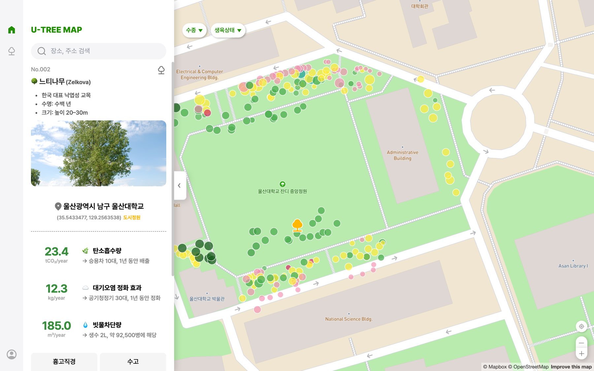
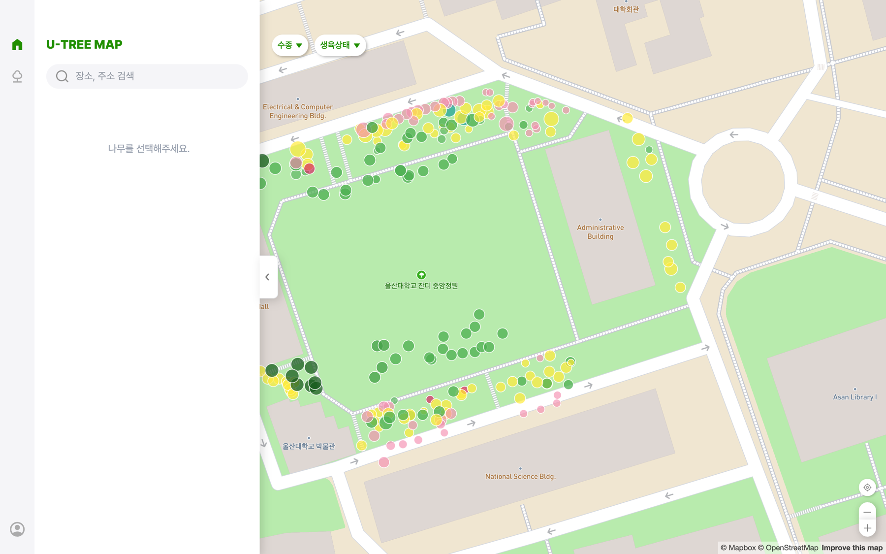
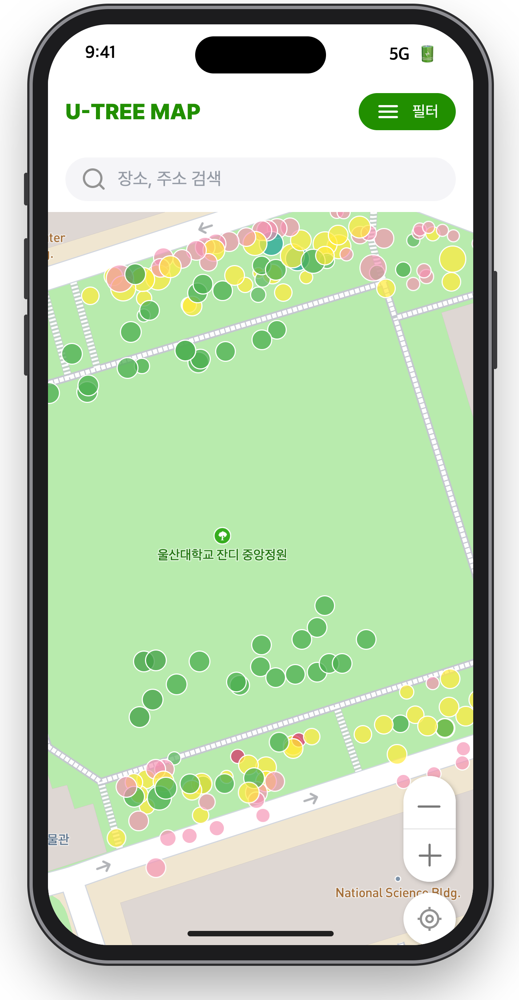
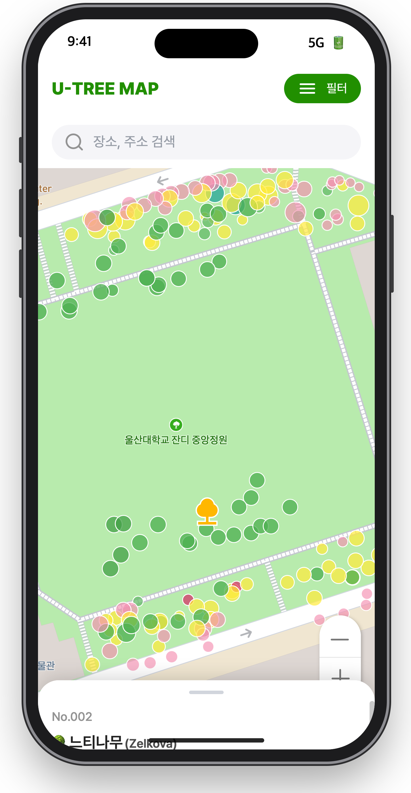

# 🌳 K-TreeMap (U-TreeMap) Front-End

**시민참여 기반 도시 수목 탄소저장 데이터 플랫폼**
도시 수목의 위치·수종·생육 상태와 탄소저장량을 지도 위에서 한눈에 확인하는 웹 서비스입니다.

🔗 **서비스 바로가기 → [map.k-treemap.site/map](https://map.k-treemap.site/map)**

> 2026 한이음 드림업 프로젝트 · 울산 시범지역 (울산대학교 일대)

<p align="center">
  
</p>

---

## 📌 서비스 소개

도시숲과 가로수는 탄소저장, 대기정화, 열섬완화 같은 핵심 생태서비스를 제공하지만, 기존 녹지 관리는 면적·시설 중심이라 **나무 한 그루가 하는 일**을 파악하기 어려웠습니다.
또한 전문가 중심 조사만으로는 데이터 갱신 속도와 범위에 한계가 있습니다.

**K-TreeMap**은 이 문제를 수목 단위 데이터와 시민 참여로 풉니다.

- 🗺 **수목 단위 관리** — 위치, 수종, 크기, 생육 상태, 사진을 나무 한 그루마다 기록합니다.
- 🌍 **생태서비스 가시화** — 탄소흡수량, 대기오염 정화 효과, 빗물차단량을 쉬운 비유(승용차 10대, 공기청정기 30대 등)와 함께 보여줍니다.
- 🙋 **시민 참여 + 관리자 검증** — 시민·자원봉사자가 현장에서 수집하고, 관리자가 승인한 데이터만 공식 지도에 반영하는 구조를 지향합니다.
- 🌱 **확장 가능한 구조** — 울산을 시작으로 2028 울산 국제정원박람회 연계와 전국 단위 확장을 염두에 두고 설계했습니다.

### 활용 분야
도시 녹지 관리 · 탄소중립 정책 수립 · 스마트시티/ESG 데이터 인프라 · 환경교육 및 시민 캠페인

---

## 🖼 화면 미리보기

### Desktop
사이드바에서 장소·주소를 검색하고, 지도 위 마커를 눌러 수목 상세 정보를 확인합니다.

| 지도 탐색 | 수목 상세 |
|:---:|:---:|
|  |  |

### Mobile
상단 검색창과 필터, 하단 바텀시트 중심으로 작은 화면과 현장 이용에 맞췄습니다.

| 지도 탐색 | 수목 상세 (바텀시트) |
|:---:|:---:|
|  |  |

> 마커 색상은 수목의 생육 상태를 나타냅니다.

---

## ✨ 주요 기능

### 현재 제공 중
| 기능 | 설명 |
|---|---|
| 지도 기반 수목 조회 | Mapbox GL 지도에서 수목 위치를 마커로 표시 |
| 줌 레벨별 시각화 | 축소 시 행정구역(폴리곤) 단위 집계, 확대 시 개별 수목 마커로 전환 |
| 가시영역 중심 로딩 | 화면에 보이는 영역의 데이터만 요청하고 캐싱해 대량 마커도 부드럽게 처리 |
| 수목 상세 정보 | 수종, 수명, 크기, 사진, 주소·좌표와 탄소흡수량·대기정화·빗물차단량 제공 |
| 필터 / 검색 | 수종·생육 상태 필터, 장소·주소 검색 |
| 내 위치 | GPS 기반 현재 위치로 이동 |
| 반응형 UI | 데스크톱은 사이드바, 모바일은 바텀시트 + 필터 버튼 |
| API 연동 | Spring Boot REST API로 수목 마커·상세·지역 데이터 조회 |

### 개발 예정
- 시민 참여 수목 등록 (GPS·카메라 기반 현장 수집, 수정 요청)
- 관리자 검증 워크플로 (승인/반려, 자원봉사자 초대, 교육자료)
- 지역별 통계·히트맵 대시보드
- 대규모 필터링 / 검색 고도화

---

## 🏗 서비스 구조

```
 사용자 (Desktop / Mobile Web)
        │
        ▼
 ┌───────────────────────────┐
 │ React + Mapbox GL (이 저장소) │  Zustand 상태관리 · Axios API Client
 └───────────────────────────┘
        │  REST API (/api)
        ▼
 ┌───────────────────────────┐
 │ Spring Boot (U-TreeMap-BE) │  수목 조회 · 탄소저장량 산정 · 검증
 └───────────────────────────┘
        │
        ▼
 ┌───────────────────────────┐
 │ DB (U-TreeMap-DB) · 이미지 저장소 │
 └───────────────────────────┘
```

Nginx로 프론트를 서빙하고 `/api`를 백엔드로 프록시하는 Docker 스택은 [U-TreeMap](https://github.com/U-TreeMap/U-TreeMap) 저장소를 참고하세요.

| 저장소 | 역할 |
|---|---|
| **U-TreeMap-FE** (현재) | React 프론트엔드 |
| [U-TreeMap-BE](https://github.com/U-TreeMap/U-TreeMap-BE) | Spring Boot REST API |
| [U-TreeMap-DB](https://github.com/U-TreeMap/U-TreeMap-DB) | DB 초기화 · 데이터 적재 |
| [U-TreeMap](https://github.com/U-TreeMap/U-TreeMap) | Docker Compose 배포 스택 |

---

## 🛠 Tech Stack

| Category | Tech |
|---|---|
| Framework | **React 19**, **Vite** |
| Styling | **Tailwind CSS v4** |
| State Management | **Zustand** |
| Map | **Mapbox GL JS** |
| HTTP | **Axios** |
| UI | vaul (바텀시트), react-responsive |
| Lint | ESLint |

---

## 🚀 시작하기

### 1. 설치 및 실행
```bash
cd U-TreeMap-FrontEnd
yarn install
yarn dev        # http://localhost:5173
```

### 2. 환경 변수
`U-TreeMap-FrontEnd/.env` 파일을 만들어 아래 값을 설정합니다. (Mapbox 토큰은 팀원에게 전달받으세요. 저장소에 커밋하지 않습니다.)

```
VITE_MAPBOX_TOKEN=<your-mapbox-token>
VITE_API_BASE_URL=
```

팀 공용 `.env` 공유 방법은 [docs/dotenv-vault.md](docs/dotenv-vault.md)를 참고하세요.

### 3. 빌드
```bash
yarn build
```

---

## 📁 프로젝트 구조

```
U-TreeMap-FrontEnd
├─ src
│  ├─ api/            # 수목·지역 API 호출
│  ├─ assets/         # 아이콘, 이미지
│  ├─ components/     # MapBox, SideBar, MobileBottomSheet, UI
│  ├─ features/map/   # 마커, 줌 제어, 히트맵, 라벨, 위치 이동
│  ├─ hooks/          # 선택된 수목 등 커스텀 훅
│  ├─ pages/          # MainPage(Desktop), MobilePage
│  ├─ stores/         # Zustand 스토어
│  └─ utils/
└─ public/
```

## 📚 문서

| 문서 | 내용 |
|---|---|
| [setup.md](docs/setup.md) | 개발 환경 설정 |
| [architecture.md](docs/architecture.md) | 아키텍처 |
| [map-system.md](docs/map-system.md) | 지도 렌더링 시스템 |
| [development-guide.md](docs/development-guide.md) | 개발 가이드 |
| [feature-roadmap.md](docs/feature-roadmap.md) | 기능 로드맵 |

---

## 👥 Developers

| Name | Role | Github |
|---|---|---|
| **이하은** | Front-End Developer | [@OZVSHHH](https://github.com/OZVSHHH) |
| **김성원** | Front-End Developer | - |

---

## 🤝 Contributing

버그 제보와 개선 제안은 이슈로 남겨주세요. 기능 단위 브랜치에서 작업하고 Pull Request로 리뷰를 받습니다.

## 📄 License

추후 지정
